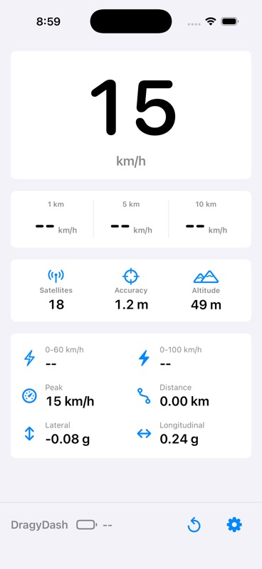

# DragyDash

[](https://github.com/jremick/dragy-dash/actions/workflows/ci.yml)
[](https://github.com/jremick/dragy-dash/actions/workflows/codeql.yml)
[](LICENSE)


An experimental, open-source iOS dashboard for displaying live Dragy Pro GNSS telemetry over Bluetooth LE — with zero cloud account, clean portrait & landscape cockpit layouts, and a **Dynamic Island Live Activity** so you can keep live GPS speed visible while navigating in Maps or Waze.

> **Unofficial project:** DragyDash is not affiliated with, endorsed by, or supported by Dragy. BLE protocol notes are based on limited hands-on testing and may not apply to every hardware revision or firmware version.



## Why DragyDash?

- **Glanceable cockpit UI:** Huge monospaced speed display, live connection & GPS quality pill, auto-wake screen while driving, and adaptive landscape layout for horizontal dash mounts.
- **Dynamic Island & Lock Screen speed:** Keep live speed and battery visible via ActivityKit while running navigation apps.
- **Zero-account, privacy-first telemetry:** Works completely offline. Saved CSV sessions are excluded from iCloud backups, support one-toggle GPS coordinate redaction, and copied BLE diagnostic logs redact coordinates, GNSS payloads, and device IDs by default.
- **Zero third-party dependencies:** Pure Swift 6, SwiftUI (`@Observable`), CoreBluetooth, and ActivityKit.

## DragyDash Ecosystem

| Project | Target | Best For |
| :--- | :--- | :--- |
| **[dragy-dash](https://github.com/jremick/dragy-dash)** *(this repo)* | iPhone (iOS 18+, Swift 6) | Full cockpit dashboard, Dynamic Island Live Activity, launch timing, and CSV export |
| **[dragy-dash-esp32](https://github.com/jremick/dragy-dash-esp32)** | LilyGO T-Display-S3 (ESP32-S3) | Dedicated ~$20 standalone hardware HUD with browser-based flashing — no phone required |

## Highlights

- **Direct CoreBluetooth BLE:** Service-targeted `FD00` discovery (background-compatible), `FD03` challenge-response handshake after `FD02` notify setup, auto-reconnect, and manual device picker in Settings.
- **Hardened GNSS Decoding:** Checksum-verified UBX `NAV-PVT` reassembly and decoding (`iTOW` timing, speed, satellites, `hAcc`, altitude, heading) plus `FD04` battery status and NMEA/SPP fallbacks.
- **Real-Time Stats Engine:** O(1) sliding-window rolling speed averages (`1 / 5 / 10 km` or `1 / 3 / 5 mi`), stationary-armed launch detection for best-of-session 0-60 / 0-100 timing, peak speed, distance, and GNSS-derived lateral/longitudinal G.
- **Privacy-Safe Exports & Diagnostics:** Rolling retention of the 3 newest CSV sessions (with optional coordinate redaction and formula sanitization) plus one-tap redacted BLE diagnostic reports.
- **Simulator-Ready:** Built-in mock telemetry mode (also toggleable on device in Settings) and Swift Testing unit test suite.

## Compatibility

| Hardware | BLE Prefix / Service | Status | Notes |
| :--- | :--- | :--- | :--- |
| **Dragy Pro (`DRG70`)** | `DRG70-*` / `FD00` | Tested | Live UBX NAV-PVT stream + `FD04` battery |
| **Dragy v1 (`DRG69`)** | `DRG69-*` / `FCFF` | Experimental / Untested | Legacy SPP polling fallback present; feedback welcome via [Hardware Compatibility Issues](https://github.com/jremick/dragy-dash/issues/new?template=hardware_compatibility.yml) |

> **Note:** Observed Dragy Pro hardware serves one active BLE central at a time. Disconnect the official Dragy app or [DragyDash ESP32](https://github.com/jremick/dragy-dash-esp32) before connecting.

## How It Works

1. Scans for `FD00` / `DRG*` peripherals and connects to the Dragy Pro.
2. Subscribes to `FD02` (telemetry stream) and `FD04` (device status / battery) without touching `FD05` (MCU update) or `FD11` (factory test).
3. Performs the `FD03` challenge-response (`[a, b, a XOR b, a AND b]`) once `FD02` notifications are active.
4. Reassembles fragmented UBX `NAV-PVT` frames, verifies checksums, filters stationary GNSS jitter (5 km/h start / 2 km/h stop hysteresis), and updates the dashboard & Live Activity.

Detailed protocol observations are in [docs/DRAGY_CAPTURE.md](docs/DRAGY_CAPTURE.md) and ActivityKit notes in [docs/LIVE_ACTIVITY.md](docs/LIVE_ACTIVITY.md).

## Build & Test

Requirements:

- macOS with Xcode 16+ (iOS 18 SDK or newer)
- [XcodeGen](https://github.com/yonaskolb/XcodeGen)

```bash
git clone https://github.com/jremick/dragy-dash.git
cd dragy-dash
swift tools/generate_app_icon.swift
xcodegen generate
xcodebuild -project DragyDash.xcodeproj -scheme DragyDash \
  -destination 'platform=iOS Simulator,name=iPhone 17,OS=latest' test
```

If `iPhone 17` is not installed locally, pick any available iPhone simulator from `xcrun simctl list devices available`.

## Sideloading on a Physical iPhone

Bluetooth and Live Activity behavior must be verified on a physical iPhone (Simulator uses mock telemetry).

1. Open `DragyDash.xcodeproj` in Xcode.
2. Select your Apple Development Team on both **DragyDash** and **DragyDashLiveActivityExtension**.
3. Replace the public placeholder bundle IDs:
   - `com.example.dragydash` -> `com.<your-domain>.dragydash`
   - `com.example.dragydash.liveactivity` -> `com.<your-domain>.dragydash.liveactivity`
4. Build and run to your iPhone (or install via `devicectl`):

```bash
xcodebuild -project DragyDash.xcodeproj -scheme DragyDash \
  -destination 'platform=iOS,id=<DEVICE_UDID>' \
  -allowProvisioningUpdates -allowProvisioningDeviceRegistration build
xcrun devicectl device install app --device <DEVICE_UDID> \
  ~/Library/Developer/Xcode/DerivedData/DragyDash-*/Build/Products/Debug-iphoneos/DragyDash.app
xcrun devicectl device process launch --device <DEVICE_UDID> --terminate-existing <YOUR_APP_BUNDLE_ID>
```

## Project Layout

- `DragyDash/Services/DragyBluetoothService.swift`: Targeted `FD00` BLE scan/connect/reconnect, ordered `FD02` -> `FD03` handshake, `FD04` battery parsing.
- `DragyDash/Services/DragyPacketReassembler.swift`: Checksum-validated fragmented UBX stream reassembly.
- `DragyDash/Services/DragyPacketDecoder.swift`: UBX `NAV-PVT`, NMEA, and SPP telemetry decoding.
- `DragyDash/Services/TelemetryRecorder.swift`: O(1) rolling distance averages, launch-detected acceleration timing, ring-buffered samples, and safe CSV export.
- `DragyDash/Services/BLEDiagnosticReport.swift`: Privacy-redacted BLE diagnostic report generator.
- `DragyDash/Services/LiveSpeedActivityController.swift` & `DragyDashLiveActivityExtension/`: ActivityKit Dynamic Island & Lock Screen Live Activity.
- `DragyDashTests/`: Swift Testing unit test suites covering decoding, reassembly, filtering, motion estimation, recording, session storage, and redaction.

## Safety & Privacy

Do not interact with the app while driving. Mount your phone securely, obey local road laws, and never rely on experimental telemetry as your sole speedometer or compliance instrument.

Never post raw BLE captures, unredacted CSV sessions, route coordinates, full Dragy serial suffixes, or Apple signing details in public issues. See [SECURITY.md](SECURITY.md) and [CONTRIBUTING.md](CONTRIBUTING.md).

## License

[Apache License 2.0](LICENSE).
