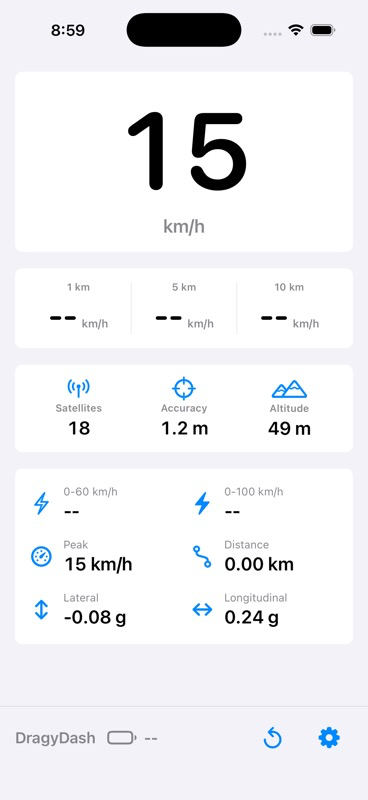

# DragyDash

An experimental iOS dashboard for displaying live Dragy Pro GNSS telemetry over Bluetooth LE.

DragyDash is a driver-readable SwiftUI speedometer that connects directly to a Dragy Pro, decodes live GNSS packets, and shows speed, GPS quality, rolling speed averages, session stats, saved CSV sessions, and an optional Dynamic Island Live Activity.

> Unofficial project: DragyDash is not affiliated with, endorsed by, or supported by Dragy. The BLE protocol notes are based on limited hands-on testing and may not apply to every device or firmware version.



## Highlights

- Direct CoreBluetooth discovery and connection for Dragy-style `DRG*` / `FD00` devices.
- Dragy Pro `FD03` challenge response and `FD02` UBX NAV-PVT stream reassembly.
- Large live speed display with metric and imperial unit modes.
- GPS quality card for satellites, horizontal accuracy, and altitude.
- Rolling speed averages:
  - Metric: 1 km, 5 km, 10 km.
  - Imperial: 1 mi, 3 mi, 5 mi.
- Session stats for peak speed, distance, lateral G, longitudinal G, 0-60, and 0-100 timing.
- Saved CSV session export with retention capped to the newest three saved sessions.
- Optional ActivityKit Live Activity for Lock Screen and Dynamic Island speed display.
- Simulator-safe mock telemetry for UI work and unit tests.

## Screens

- **Dashboard:** live speed, rolling averages, GPS quality, session stats, reset, battery, and settings.
- **Settings:** unit system, Live Activity toggle, session saving/export, and Dragy scan controls.
- **Dynamic Island:** compact speed on the leading side, unit on the trailing side, and expanded status details.

See [Live Activity notes](docs/LIVE_ACTIVITY.md) for the background update limitations that apply to all iOS Live Activities.

## How It Works

The app looks for a Dragy-like BLE peripheral, connects to the `FD00` service, performs the `FD03` challenge response, subscribes to the `FD02` telemetry stream, and decodes UBX NAV-PVT-like packets.

Decoded live values include:

- fix quality
- satellite count
- latitude and longitude
- altitude
- horizontal accuracy
- ground speed from NAV-PVT `gSpeed`
- heading of motion
- battery percentage from observed `FD04` status packets

No-fix samples are kept in raw session exports for diagnostics, but they do not feed distance, peak speed, acceleration timing, or rolling speed averages.

Detailed notes are in [Dragy Pro BLE Notes](docs/DRAGY_CAPTURE.md).

## Build

Requirements:

- macOS with Xcode
- iOS 18 SDK or newer
- [XcodeGen](https://github.com/yonaskolb/XcodeGen)

```bash
git clone https://github.com/jremick/dragy-dash.git
cd dragy-dash
swift tools/generate_app_icon.swift
xcodegen generate
xcodebuild -project DragyDash.xcodeproj -scheme DragyDash -destination 'platform=iOS Simulator,name=iPhone 17,OS=latest' test
```

If your local simulator list does not include `iPhone 17`, use any available iPhone simulator shown by:

```bash
xcrun simctl list devices available
```

## Device Install

Bluetooth and Live Activity behavior must be tested on a physical iPhone. Simulator builds are useful for layout and unit tests only.

Before installing on a phone:

1. Open `DragyDash.xcodeproj` in Xcode.
2. Select your development team.
3. Change the app and Live Activity bundle identifiers from the public placeholders:
   - `com.example.dragydash`
   - `com.example.dragydash.liveactivity`
4. Build and run on your device from Xcode, or use `xcodebuild` with your own signing configuration.

Command-line install shape:

```bash
xcodebuild -project DragyDash.xcodeproj -scheme DragyDash -destination 'platform=iOS,id=<DEVICE_UDID>' -allowProvisioningUpdates -allowProvisioningDeviceRegistration build
xcrun devicectl device install app --device <DEVICE_UDID> ~/Library/Developer/Xcode/DerivedData/DragyDash-*/Build/Products/Debug-iphoneos/DragyDash.app
xcrun devicectl device process launch --device <DEVICE_UDID> --terminate-existing <YOUR_APP_BUNDLE_ID>
```

## Project Layout

- `DragyDash/Services/DragyBluetoothService.swift`: BLE scan/connect/discovery, FD03 handshake, FD02 stream routing, FD04 battery parsing.
- `DragyDash/Services/DragyPacketDecoder.swift`: UBX NAV-PVT, NMEA, and SPP speed decoding.
- `DragyDash/Services/DragyPacketReassembler.swift`: fragmented CoreBluetooth notification reassembly.
- `DragyDash/Services/TelemetryRecorder.swift`: session stats, acceleration targets, rolling averages, sample caps, CSV export.
- `DragyDash/Services/LiveSpeedActivityController.swift`: app-side ActivityKit start/update/end flow.
- `DragyDashLiveActivityExtension/`: WidgetKit Live Activity and Dynamic Island UI.
- `docs/DRAGY_CAPTURE.md`: sanitized Dragy Pro BLE/protocol notes.
- `docs/LIVE_ACTIVITY.md`: Live Activity behavior and limitations.
- `tools/generate_app_icon.swift`: deterministic app icon generator.

## Safety

Do not interact with the app while driving. Mount the phone securely, obey local road laws, and verify speed against safe/legal instrumentation before relying on any displayed value.

This app is experimental and should not be used as the sole source of speed, vehicle state, or compliance information.

## Privacy

DragyDash can decode and export route coordinates. Do not commit raw BLE captures, exported sessions, route coordinates, full Dragy identifiers, or diagnostic reports unless they have been intentionally sanitized.

Public issues should use redacted examples only. See [SECURITY.md](SECURITY.md) for reporting guidance.

## License

[Apache License 2.0](LICENSE).
